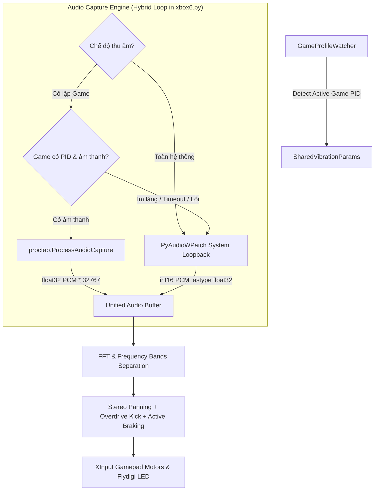

# Per-Process Audio Isolation (Phase 2) Implementation Plan

> **For agentic workers:** REQUIRED SUB-SKILL: Use superpowers:subagent-driven-development to implement this plan task-by-task. Steps use checkbox (`- [x]`) syntax for tracking.

**Goal:** Tách riêng nguồn thu âm thanh theo ứng dụng (Per-Process Audio Capture qua `proctap`) để chỉ bắt âm thanh từ Game đang chơi, triệt tiêu 100% tạp âm Discord/YouTube/Browser, có cơ chế tự động Fallback về âm thanh hệ thống khi game im lặng.

**Architecture:** Bổ sung cơ chế hybrid stream bên trong `audio_vibration_thread` của [xbox6.py](file:///c:/Users/LapTopNhatAn/Downloads/Compressed/XboxAudioRumbleStudio-windows-x64-v1.0.1/xbox6.py). Luồng watcher truyền `PID` của Game đang chơi vào `SharedVibrationParams`. Audio engine mở `ProcessAudioCapture(pid)` từ `proctap` (WASAPI Process Loopback C++) và chuyển đổi `float32 * 32767.0` sang phổ FFT Haptic hiện tại. Nếu Game im lặng hoặc timeout, tự động tráo mượt mà sang `PyAudioWPatch` (System Loopback). Bổ sung tùy chọn chọn nguồn âm thanh trên giao diện Tkinter.

**Architecture Diagram:**



**Tech Stack:** Python 3.11, `proctap` (C++ WASAPI Process Loopback), `scipy`, `PyAudioWPatch`, `numpy`, Tkinter, PyInstaller, Inno Setup 6.

**Spec:** [docs/superpowers/specs/2026-10-11-per-process-audio-isolation-design.md](file:///c:/Users/LapTopNhatAn/Downloads/Compressed/XboxAudioRumbleStudio-windows-x64-v1.0.1/docs/superpowers/specs/2026-10-11-per-process-audio-isolation-design.md)

## Global Constraints

- Độ trễ âm thanh xúc giác thời gian thực giữ ở mức cực thấp (< 5ms).
- Biên độ tín hiệu âm thanh thu từ `proctap` (`float32`) khi nhân với `32767.0` phải tương thích 1:1 với bộ lọc FFT và các công thức Haptic hiện hữu.
- Cơ chế Fallback sang âm thanh hệ thống phải chạy tự động, không để tay cầm bị mất rung vô cớ khi game đang tải màn hoặc chưa có âm thanh.
- Giữ nguyên vẹn 100% phong cách giao diện Dark Mode tiếng Việt và lưu cấu hình vào `XboxAudioRumbleStudio.settings.json`.

---

### Task 1: Mở Rộng Schema Cài Đặt & SharedVibrationParams

**Files:**
- Modify: [xbox6.py:465-535](file:///c:/Users/LapTopNhatAn/Downloads/Compressed/XboxAudioRumbleStudio-windows-x64-v1.0.1/xbox6.py#L465-L535)
- Test: [test_phase2_schema.py](file:///c:/Users/LapTopNhatAn/Downloads/Compressed/XboxAudioRumbleStudio-windows-x64-v1.0.1/test_phase2_schema.py)

**Interfaces:**
- Produces: `audio_capture_mode: str`, `auto_process_fallback: bool`, `current_game_pid: int` trong `SharedVibrationParams` & `RuntimeStats`.

- [x] **Step 1: Viết test kiểm tra schema Phase 2**

Tạo file `test_phase2_schema.py`:
```python
from xbox6 import SharedVibrationParams

def test_phase2_schema_defaults():
    params = SharedVibrationParams()
    assert hasattr(params, "audio_capture_mode")
    assert hasattr(params, "auto_process_fallback")
    assert hasattr(params, "current_game_pid")
    assert params.audio_capture_mode in {"system", "auto_game_process"}
    assert params.auto_process_fallback is True

    snap = params.snapshot()
    assert "audio_capture_mode" in snap
    assert "auto_process_fallback" in snap
    assert "current_game_pid" in snap

if __name__ == "__main__":
    test_phase2_schema_defaults()
    print("PHASE 2 SCHEMA TEST PASSED")
```

- [x] **Step 2: Chạy test để xác nhận FAIL trước khi sửa code**

Run: `python test_phase2_schema.py`
Expected: FAIL với AttributeError vì các thuộc tính chưa được khai báo.

- [x] **Step 3: Bổ sung các trường vào SharedVibrationParams và snapshot() trong xbox6.py**

Cập nhật `RuntimeStats` và `SharedVibrationParams`:
```python
    audio_capture_mode: str = "auto_game_process"
    auto_process_fallback: bool = True
    current_game_pid: int = 0
```
Và cập nhật trong `snapshot()`:
```python
    "audio_capture_mode": self.audio_capture_mode,
    "auto_process_fallback": self.auto_process_fallback,
    "current_game_pid": self.current_game_pid,
```

- [x] **Step 4: Chạy test để xác nhận PASS**

Run: `python test_phase2_schema.py`
Expected: PASS ("PHASE 2 SCHEMA TEST PASSED").

---

### Task 2: Triển Khai Module Bộ Thu Âm Hỗn Hợp (Hybrid Audio Loop)

**Files:**
- Modify: [xbox6.py:650-760](file:///c:/Users/LapTopNhatAn/Downloads/Compressed/XboxAudioRumbleStudio-windows-x64-v1.0.1/xbox6.py#L650-L760)
- Test: [test_process_audio_stream.py](file:///c:/Users/LapTopNhatAn/Downloads/Compressed/XboxAudioRumbleStudio-windows-x64-v1.0.1/test_process_audio_stream.py)

**Interfaces:**
- Consumes: `proctap.ProcessAudioCapture`, `SharedVibrationParams.current_game_pid`, `SharedVibrationParams.audio_capture_mode`.
- Produces: `raw_samples: np.ndarray` (float32 scale [-32768, 32767]) sẵn sàng cho FFT.

- [x] **Step 1: Viết test cho ProcessAudioCapture và chuyển đổi float32 sang int16 scale**

Tạo file `test_process_audio_stream.py`:
```python
import os
import numpy as np
import proctap

def test_proctap_conversion():
    pid = os.getpid()
    cap = proctap.ProcessAudioCapture(pid)
    cap.start()
    assert cap.is_running is True
    fmt = cap.get_format()
    assert fmt["sample_rate"] > 0
    cap.stop()

    # Test scale conversion
    dummy_float = np.array([-1.0, 0.0, 0.5, 1.0], dtype=np.float32)
    scaled = dummy_float * 32767.0
    assert scaled[0] == -32767.0
    assert scaled[3] == 32767.0

if __name__ == "__main__":
    test_proctap_conversion()
    print("PROCTAP AUDIO TEST PASSED")
```

- [x] **Step 2: Chạy test để xác nhận PASS**

Run: `python test_process_audio_stream.py`
Expected: PASS.

- [x] **Step 3: Tích hợp Hybrid Stream vào audio_vibration_thread trong xbox6.py**

Trong `audio_vibration_thread`:
- Quản lý `current_proc_cap: Optional[proctap.ProcessAudioCapture] = None` và `active_capture_pid: int = 0`.
- Khi `snap["audio_capture_mode"] == "auto_game_process"` và `snap["current_game_pid"] > 0`:
  - Nếu `active_capture_pid != snap["current_game_pid"]`:
    - Dừng `current_proc_cap` cũ (nếu có).
    - Khởi tạo `current_proc_cap = proctap.ProcessAudioCapture(snap["current_game_pid"])`.
    - Gọi `current_proc_cap.start()`.
    - `active_capture_pid = snap["current_game_pid"]`.
  - Đọc `raw_proc = current_proc_cap.read(timeout=0.015)`.
  - Nếu `raw_proc` có dữ liệu:
    - `raw_samples = np.frombuffer(raw_proc, dtype=np.float32) * 32767.0`
    - Cập nhật `device_name`: `🎯 Đang cô lập: [PID {active_capture_pid}]`
    - Đánh dấu `last_proc_audio_time = time.monotonic()`.
  - Nếu `raw_proc` là None (game im lặng hoặc timeout > 1.2s):
    - Đọc từ `stream.read(chunk, exception_on_overflow=False)`.
    - Cập nhật `device_name`: `🔄 Fallback: Âm thanh hệ thống (Chờ PID {active_capture_pid})`.
- Ngược lại (chế độ Toàn hệ thống hoặc không có game PID):
  - Dừng `current_proc_cap` nếu đang chạy.
  - Đọc trực tiếp từ `stream.read(chunk, exception_on_overflow=False)`.

---

### Task 3: Đồng Bộ PID Game Từ GameProfileWatcher

**Files:**
- Modify: [xbox6.py:1000-1060](file:///c:/Users/LapTopNhatAn/Downloads/Compressed/XboxAudioRumbleStudio-windows-x64-v1.0.1/xbox6.py#L1000-L1060)
- Modify: [xbox6.py:2200-2240](file:///c:/Users/LapTopNhatAn/Downloads/Compressed/XboxAudioRumbleStudio-windows-x64-v1.0.1/xbox6.py#L2200-L2240)
- Test: [test_watcher_pid.py](file:///c:/Users/LapTopNhatAn/Downloads/Compressed/XboxAudioRumbleStudio-windows-x64-v1.0.1/test_watcher_pid.py)

**Interfaces:**
- Produces: `get_foreground_process_info() -> tuple[str, int]`, cập nhật `shared.current_game_pid`.

- [x] **Step 1: Viết test lấy thông tin process (tên và PID)**

Tạo file `test_watcher_pid.py`:
```python
from xbox6 import get_foreground_process_info

def test_foreground_pid():
    name, pid = get_foreground_process_info()
    assert isinstance(name, str)
    assert isinstance(pid, int)
    print(f"Foreground: {name} (PID: {pid})")

if __name__ == "__main__":
    test_foreground_pid()
    print("WATCHER PID TEST PASSED")
```

- [x] **Step 2: Chạy test để xác nhận FAIL trước khi sửa code**

Run: `python test_watcher_pid.py`
Expected: FAIL vì `get_foreground_process_info` chưa có.

- [x] **Step 3: Triển khai get_foreground_process_info và cập nhật _game_watcher_loop()**

Trong `xbox6.py`:
```python
def get_foreground_process_info():
    try:
        hwnd = win32gui.GetForegroundWindow()
        if not hwnd:
            return "", 0
        _, pid = win32process.GetWindowThreadProcessId(hwnd)
        if pid <= 0:
            return "", 0
        return psutil.Process(pid).name().lower(), pid
    except Exception:
        return "", 0
```
Trong `_game_watcher_loop()`:
- Khi nhận diện game mục tiêu:
  ```python
  with self.shared.lock:
      self.shared.current_game_pid = proc_pid
  ```
- Khi rời khỏi game:
  ```python
  with self.shared.lock:
      self.shared.current_game_pid = 0
  ```

- [x] **Step 4: Chạy test để xác nhận PASS**

Run: `python test_watcher_pid.py`
Expected: PASS ("WATCHER PID TEST PASSED").

---

### Task 4: Tích Hợp Điều Khiển Giao Diện & Cài Đặt (GUI & Settings)

**Files:**
- Modify: [xbox6.py:1620-1660](file:///c:/Users/LapTopNhatAn/Downloads/Compressed/XboxAudioRumbleStudio-windows-x64-v1.0.1/xbox6.py#L1620-L1660)
- Modify: [xbox6.py:1940-1970](file:///c:/Users/LapTopNhatAn/Downloads/Compressed/XboxAudioRumbleStudio-windows-x64-v1.0.1/xbox6.py#L1940-L1970)

**Interfaces:**
- Produces: Combobox / Radiobutton lựa chọn nguồn thu âm thanh trên Panel 1, hiển thị trạng thái động trên `device_label`.

- [x] **Step 1: Thêm Widget lựa chọn nguồn thu âm thanh vào Panel 1**

Trong `create_widgets()` (Panel 1):
- Thêm hàng điều khiển nguồn thu âm thanh:
  - Label: `Nguồn thu âm`
  - Combobox `self.audio_mode_combo`:
    - `🎯 Tự động cô lập Game đang chơi`
    - `🔊 Toàn hệ thống Windows (Mặc định)`
  - Liên kết với `self.audio_mode_var` và gọi `self.set_audio_capture_mode()`.

- [x] **Step 2: Triển khai phương thức set_audio_capture_mode() và đồng bộ**

```python
def set_audio_capture_mode(self):
    val = "auto_game_process" if "Tự động cô lập" in self.audio_mode_var.get() else "system"
    with self.shared.lock:
        self.shared.audio_capture_mode = val
    self.log_queue.put(f"Chế độ nguồn thu âm: {self.audio_mode_var.get()}")
    self.save_settings()
```
Trong `sync_controls_from_params()`:
- Đồng bộ giá trị hiển thị tương ứng từ `snap["audio_capture_mode"]`.

---

### Task 5: Kiểm Thử Toàn Diện & Đóng Gói Re-release (.exe & Setup v1.2.0)

**Files:**
- Output: `XboxAudioRumbleStudio.exe`
- Output: `XboxAudioRumbleStudio-Setup-v1.2.0.exe`
- Modify: [installer.iss](file:///c:/Users/LapTopNhatAn/Downloads/Compressed/XboxAudioRumbleStudio-windows-x64-v1.0.1/installer.iss)
- Modify: [README.md](file:///c:/Users/LapTopNhatAn/Downloads/Compressed/XboxAudioRumbleStudio-windows-x64-v1.0.1/README.md)

- [x] **Step 1: Kiểm thử cú pháp toàn bộ file mã nguồn**

Run: `python -m py_compile xbox6.py`
Expected: Exit code 0, không có lỗi.

- [x] **Step 2: Chạy smoke test ứng dụng trong 3 giây**

Run: `python -c "import subprocess, time; p = subprocess.Popen(['python', 'xbox6.py']); time.sleep(3); p.terminate()"`
Expected: Khởi động và thoát sạch sẽ không có ngoại lệ.

- [x] **Step 3: Đóng gói lại file thực thi duy nhất bằng PyInstaller**

Run: `pyinstaller --noconfirm --onefile --windowed --icon=app.ico --name=XboxAudioRumbleStudio --collect-all proctap --collect-all scipy --distpath=. xbox6.py`
Expected: Exit code 0, tạo file `XboxAudioRumbleStudio.exe`.

- [x] **Step 4: Cập nhật installer.iss lên v1.2.0 và biên dịch lại Setup**

Nâng `MyAppVersion` lên `"1.2.0"` và `OutputBaseFilename=XboxAudioRumbleStudio-Setup-v1.2.0`.
Run: `& "C:\Users\LapTopNhatAn\AppData\Local\Programs\Inno Setup 6\ISCC.exe" installer.iss`
Expected: Tạo thành công `XboxAudioRumbleStudio-Setup-v1.2.0.exe`.

- [x] **Step 5: Dọn dẹp test tạm và commit Git**

Xóa các file test tạm: `test_phase2_schema.py`, `test_process_audio_stream.py`, `test_watcher_pid.py`.
Commit Git toàn bộ tính năng Phase 2 lên nhánh `main`.
