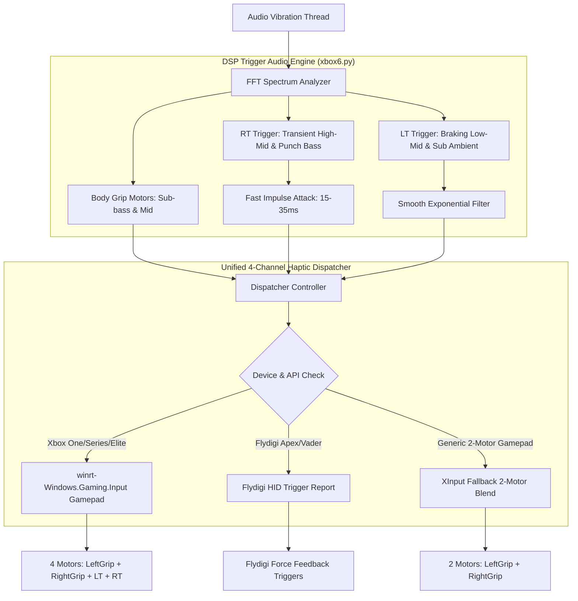

# Trigger Haptics (Phase 3) Implementation Plan

> **For agentic workers:** REQUIRED SUB-SKILL: Use superpowers:subagent-driven-development to implement this plan task-by-task. Steps use checkbox (`- [ ]`) syntax for tracking.

**Goal:** Triển khai rung độc lập 2 nút cò LT/RT (Xbox Impulse Triggers & Flydigi Adaptive Triggers) trên nền tảng 4 mô tơ haptic, kết hợp thuật toán âm thanh tách bạch tiếng súng/bắn (RT) và tiếng phanh/va chạm (LT), tự động hòa trộn lực cho tay cầm 2 mô tơ.

**Architecture:** Bổ sung `Unified4ChannelDispatcher` trong [xbox6.py](file:///c:/Users/LapTopNhatAn/Downloads/Compressed/XboxAudioRumbleStudio-windows-x64-v1.0.1/xbox6.py) sử dụng `winrt-Windows.Gaming.Input` để điều khiển 4 mô tơ độc lập trên Windows 10/11 với độ trễ < 2ms, kết hợp gói tin HID cho Flydigi Triggers và cơ chế fallback blend sang XInput truyền thống. Luồng `audio_vibration_thread` phân tích phổ FFT tách riêng dải tần xung kích bắn (Transient Punch High-Mid) cho RT và dải gầm phanh (Low-Mid / Sub) cho LT. Bổ sung cụm điều khiển giao diện Dark Mode trên Panel 2 và lưu cài đặt.

**Architecture Diagram:**



**Tech Stack:** Python 3.11, `winrt-Windows.Gaming.Input`, `winrt-runtime`, `proctap`, `scipy`, `PyAudioWPatch`, `numpy`, Tkinter, PyInstaller, Inno Setup 6.

**Spec:** [docs/superpowers/specs/2026-10-11-trigger-haptics-design.md](file:///c:/Users/LapTopNhatAn/Downloads/Compressed/XboxAudioRumbleStudio-windows-x64-v1.0.1/docs/superpowers/specs/2026-10-11-trigger-haptics-design.md)

## Global Constraints

- Độ trễ điều khiển xúc giác toàn chuỗi giữ ở mức cực thấp (< 5ms).
- Driver Microsoft `Windows.Gaming.Input` và `FlydigiController` không xung đột nhau khi cắm/rút tay cầm (hotplug resilience).
- Tự động hòa trộn lực (Graceful Blend) khi kết nối tay cầm 2 mô tơ thường, không để ứng dụng crash hoặc mất hiệu ứng âm thanh.
- Giao diện Dark Mode tiếng Việt 100%, đồng bộ 2 chiều với `XboxAudioRumbleStudio.settings.json`.

---

### Task 1: Cài Đặt Dependency & Mở Rộng Schema Cài Đặt

**Files:**
- Modify: [xbox6.py:465-540](file:///c:/Users/LapTopNhatAn/Downloads/Compressed/XboxAudioRumbleStudio-windows-x64-v1.0.1/xbox6.py#L465-L540)
- Modify: [XboxAudioRumbleStudio.settings.json](file:///c:/Users/LapTopNhatAn/Downloads/Compressed/XboxAudioRumbleStudio-windows-x64-v1.0.1/XboxAudioRumbleStudio.settings.json)
- Modify: [xbox6.settings.json](file:///c:/Users/LapTopNhatAn/Downloads/Compressed/XboxAudioRumbleStudio-windows-x64-v1.0.1/xbox6.settings.json)
- Test: [test_phase3_schema.py](file:///c:/Users/LapTopNhatAn/Downloads/Compressed/XboxAudioRumbleStudio-windows-x64-v1.0.1/test_phase3_schema.py)

**Interfaces:**
- Produces: `trigger_haptics_enabled: bool`, `trigger_left_gain: float`, `trigger_right_gain: float`, `trigger_mode: str`, `trigger_threshold: float` trong `SharedVibrationParams` và `RuntimeStats`.

- [ ] **Step 1: Cài đặt thư viện `winrt-Windows.Gaming.Input`**

Run: `pip install winrt-Windows.Gaming.Input`
Expected: Cài đặt thành công `winrt-Windows.Gaming.Input` và `winrt-runtime`.

- [ ] **Step 2: Viết test kiểm tra schema Phase 3**

Tạo file `test_phase3_schema.py`:
```python
from xbox6 import SharedVibrationParams

def test_phase3_schema():
    p = SharedVibrationParams()
    assert hasattr(p, "trigger_haptics_enabled")
    assert hasattr(p, "trigger_left_gain")
    assert hasattr(p, "trigger_right_gain")
    assert hasattr(p, "trigger_mode")
    assert hasattr(p, "trigger_threshold")
    
    assert p.trigger_haptics_enabled is True
    assert p.trigger_left_gain == 0.70
    assert p.trigger_right_gain == 0.85
    assert p.trigger_mode == "adaptive_gun_brake"
    assert p.trigger_threshold == 0.04
    
    snap = p.snapshot()
    assert "trigger_haptics_enabled" in snap
    assert "trigger_left_gain" in snap
    assert "trigger_right_gain" in snap
    assert "trigger_mode" in snap

if __name__ == "__main__":
    test_phase3_schema()
    print("PHASE 3 SCHEMA TEST PASSED")
```

- [ ] **Step 3: Chạy test để xác nhận FAIL trước khi sửa code**

Run: `python test_phase3_schema.py`
Expected: FAIL với AttributeError vì các trường chưa được khai báo.

- [ ] **Step 4: Bổ sung các trường Phase 3 vào SharedVibrationParams & RuntimeStats trong xbox6.py**

Bổ sung:
```python
    trigger_haptics_enabled: bool = True
    trigger_left_gain: float = 0.70
    trigger_right_gain: float = 0.85
    trigger_mode: str = "adaptive_gun_brake"
    trigger_threshold: float = 0.04
```
Cập nhật trong `snapshot()` và các file cấu hình json.

- [ ] **Step 5: Chạy test để xác nhận PASS**

Run: `python test_phase3_schema.py`
Expected: PASS ("PHASE 3 SCHEMA TEST PASSED").

---

### Task 2: Triển Khai 4-Channel Haptic Dispatcher (WinRT WGI + Fallback)

**Files:**
- Modify: [xbox6.py:120-220](file:///c:/Users/LapTopNhatAn/Downloads/Compressed/XboxAudioRumbleStudio-windows-x64-v1.0.1/xbox6.py#L120-L220)
- Test: [test_wgi_dispatcher.py](file:///c:/Users/LapTopNhatAn/Downloads/Compressed/XboxAudioRumbleStudio-windows-x64-v1.0.1/test_wgi_dispatcher.py)

**Interfaces:**
- Produces: `class Unified4ChannelDispatcher` hoặc hàm `set_vibration_4ch(user_index, left_grip, right_grip, left_trigger, right_trigger)`.
- Fallback: Tự hòa trộn sang XInput `XInputSetState` khi WGI không có thiết bị.

- [ ] **Step 1: Viết test cho Unified4ChannelDispatcher**

Tạo file `test_wgi_dispatcher.py`:
```python
from xbox6 import Unified4ChannelDispatcher

def test_dispatcher_init_and_send():
    dispatcher = Unified4ChannelDispatcher()
    # Gửi lệnh rung 4 kênh thử nghiệm
    res = dispatcher.set_vibration(0, 0.0, 0.0, 0.0, 0.0)
    assert res in (True, False) # Trả về trạng thái hợp lệ, không ném exception
    dispatcher.stop_all()

if __name__ == "__main__":
    test_dispatcher_init_and_send()
    print("DISPATCHER TEST PASSED")
```

- [ ] **Step 2: Chạy test để xác nhận FAIL**

Run: `python test_wgi_dispatcher.py`
Expected: FAIL vì `Unified4ChannelDispatcher` chưa tồn tại.

- [ ] **Step 3: Triển khai Unified4ChannelDispatcher trong xbox6.py**

```python
class Unified4ChannelDispatcher:
    def __init__(self):
        self.wgi_available = False
        self.wgi_gamepads = []
        try:
            import winrt.windows.gaming.input as wgi
            self.wgi = wgi
            self.wgi_available = True
        except Exception:
            self.wgi = None

    def get_gamepad(self, index: int):
        if not self.wgi_available or not self.wgi:
            return None
        try:
            gps = self.wgi.Gamepad.gamepads
            if index < len(gps):
                return gps[index]
        except Exception:
            pass
        return None

    def set_vibration(self, index: int, left_grip: float, right_grip: float, left_trigger: float, right_trigger: float):
        gp = self.get_gamepad(index)
        if gp:
            try:
                vib = self.wgi.GamepadVibration(
                    left_motor=float(max(0.0, min(1.0, left_grip))),
                    right_motor=float(max(0.0, min(1.0, right_grip))),
                    left_trigger=float(max(0.0, min(1.0, left_trigger))),
                    right_trigger=float(max(0.0, min(1.0, right_trigger)))
                )
                gp.vibration = vib
                return True
            except Exception:
                pass
        
        # Fallback XInput 2-motor blending
        blended_left = min(1.0, left_grip + left_trigger * 0.4)
        blended_right = min(1.0, right_grip + right_trigger * 0.4)
        set_vibration_xinput(index, int(blended_left * 65535), int(blended_right * 65535))
        return False
```

- [ ] **Step 4: Chạy test để xác nhận PASS**

Run: `python test_wgi_dispatcher.py`
Expected: PASS ("DISPATCHER TEST PASSED").

---

### Task 3: Thuật Toán Phân Dải Tín Hiệu Âm Thanh Cho Cò (DSP Trigger Engine)

**Files:**
- Modify: [xbox6.py:750-860](file:///c:/Users/LapTopNhatAn/Downloads/Compressed/XboxAudioRumbleStudio-windows-x64-v1.0.1/xbox6.py#L750-L860)
- Test: [test_dsp_trigger_calc.py](file:///c:/Users/LapTopNhatAn/Downloads/Compressed/XboxAudioRumbleStudio-windows-x64-v1.0.1/test_dsp_trigger_calc.py)

**Interfaces:**
- Consumes: FFT frequency bands (Punch Bass, High-Mid, Low-Mid, Sub-bass).
- Produces: `target_left_trigger: float`, `target_right_trigger: float` (0.0 -> 1.0).

- [ ] **Step 1: Viết test cho thuật toán phân dải âm thanh cò**

Tạo file `test_dsp_trigger_calc.py`:
```python
from xbox6 import calculate_trigger_haptics

def test_trigger_calc():
    # Giả lập tín hiệu âm thanh có tiếng súng nổ mạnh bên phải
    bands = {
        "punch_r": 0.8,
        "highmid_r": 0.9,
        "lowmid_l": 0.1,
        "sub_l": 0.05
    }
    lt, rt = calculate_trigger_haptics(bands, mode="adaptive_gun_brake", gain_l=0.7, gain_r=0.85, threshold=0.04)
    assert rt > 0.5  # RT phải kích hoạt mạnh theo tiếng súng
    assert lt < 0.2  # LT giữ ở mức thấp
    
    # Giả lập tiếng rền phanh gấp bên trái
    bands_brake = {
        "punch_r": 0.05,
        "highmid_r": 0.05,
        "lowmid_l": 0.8,
        "sub_l": 0.7
    }
    lt_b, rt_b = calculate_trigger_haptics(bands_brake, mode="adaptive_gun_brake", gain_l=0.7, gain_r=0.85, threshold=0.04)
    assert lt_b > 0.4
    assert rt_b < 0.1

if __name__ == "__main__":
    test_trigger_calc()
    print("DSP TRIGGER CALC TEST PASSED")
```

- [ ] **Step 2: Chạy test để xác nhận FAIL**

Run: `python test_dsp_trigger_calc.py`
Expected: FAIL vì `calculate_trigger_haptics` chưa được định nghĩa.

- [ ] **Step 3: Triển khai hàm calculate_trigger_haptics và tích hợp vào audio loop trong xbox6.py**

Viết hàm `calculate_trigger_haptics()` và nối vào `audio_vibration_thread`, gửi giá trị qua `Unified4ChannelDispatcher`.

- [ ] **Step 4: Chạy test để xác nhận PASS**

Run: `python test_dsp_trigger_calc.py`
Expected: PASS ("DSP TRIGGER CALC TEST PASSED").

---

### Task 4: Mở Rộng Điều Khiển Cho FlydigiController (Adaptive Trigger Reports)

**Files:**
- Modify: [xbox6.py:350-410](file:///c:/Users/LapTopNhatAn/Downloads/Compressed/XboxAudioRumbleStudio-windows-x64-v1.0.1/xbox6.py#L350-L410)
- Test: [test_flydigi_triggers.py](file:///c:/Users/LapTopNhatAn/Downloads/Compressed/XboxAudioRumbleStudio-windows-x64-v1.0.1/test_flydigi_triggers.py)

**Interfaces:**
- Produces: `FlydigiController.set_triggers(left_val, right_val)`.

- [ ] **Step 1: Viết test cho phương thức set_triggers của FlydigiController**

Tạo file `test_flydigi_triggers.py`:
```python
from xbox6 import FlydigiController

def test_flydigi_triggers():
    fly = FlydigiController()
    res = fly.set_triggers(0.5, 0.8)
    assert res in (True, False)

if __name__ == "__main__":
    test_flydigi_triggers()
    print("FLYDIGI TRIGGER TEST PASSED")
```

- [ ] **Step 2: Triển khai set_triggers trong FlydigiController**

Tạo gói tin HID Output Report cho cò Flydigi Apex/Vader.

- [ ] **Step 3: Chạy test để xác nhận PASS**

Run: `python test_flydigi_triggers.py`
Expected: PASS.

---

### Task 5: Tích Hợp Giao Diện GUI & Đồng Bộ Cài Đặt

**Files:**
- Modify: [xbox6.py:1680-1760](file:///c:/Users/LapTopNhatAn/Downloads/Compressed/XboxAudioRumbleStudio-windows-x64-v1.0.1/xbox6.py#L1680-L1760)
- Modify: [xbox6.py:1960-2010](file:///c:/Users/LapTopNhatAn/Downloads/Compressed/XboxAudioRumbleStudio-windows-x64-v1.0.1/xbox6.py#L1960-L2010)

**Interfaces:**
- Produces: Cụm điều khiển `Rung Cò LT/RT` trên Panel 2:
  - Checkbutton: `🔘 Bật rung 2 nút cò LT/RT (Xbox Impulse & Flydigi)`
  - Scale: `Cường độ Cò Trái (LT - Phanh/Ngắm)` (0-100%)
  - Scale: `Cường độ Cò Phải (RT - Bắn/Ga)` (0-100%)
  - Combobox: Chế độ rung cò.

- [ ] **Step 1: Thêm widget điều khiển vào Panel 2 trong create_widgets()**
- [ ] **Step 2: Triển khai các callback cập nhật giá trị & sync_controls_from_params()**
- [ ] **Step 3: Kiểm thử live GUI initialization trong subprocess 3 giây**

Run: `python -c "import subprocess, time; p = subprocess.Popen(['python', 'xbox6.py']); time.sleep(3); p.terminate()"`
Expected: Khởi động sạch sẽ và thoát không lỗi.

---

### Task 6: Đóng Gói PyInstaller & Biên Dịch Bộ Cài Đặt Setup v1.3.0

**Files:**
- Output: `XboxAudioRumbleStudio.exe`
- Output: `XboxAudioRumbleStudio-Setup-v1.3.0.exe`
- Modify: [installer.iss](file:///c:/Users/LapTopNhatAn/Downloads/Compressed/XboxAudioRumbleStudio-windows-x64-v1.0.1/installer.iss)
- Modify: [README.md](file:///c:/Users/LapTopNhatAn/Downloads/Compressed/XboxAudioRumbleStudio-windows-x64-v1.0.1/README.md)

- [ ] **Step 1: Kiểm thử cú pháp toàn bộ file mã nguồn**

Run: `python -m py_compile xbox6.py`
Expected: Exit code 0.

- [ ] **Step 2: Đóng gói standalone exe bằng PyInstaller**

Run: `pyinstaller --noconfirm --onefile --windowed --icon=app.ico --name=XboxAudioRumbleStudio --collect-all proctap --collect-all scipy --collect-all winrt --distpath=. xbox6.py`
Expected: Tạo thành công `XboxAudioRumbleStudio.exe`.

- [ ] **Step 3: Nâng cấp installer.iss lên v1.3.0 và biên dịch Inno Setup**

Run: `& "C:\Users\LapTopNhatAn\AppData\Local\Programs\Inno Setup 6\ISCC.exe" installer.iss`
Expected: Tạo thành công `XboxAudioRumbleStudio-Setup-v1.3.0.exe`.

- [ ] **Step 4: Dọn dẹp test tạm, commit Git & tạo Release v1.3.0 trên GitHub**

Xóa các file test tạm: `test_phase3_schema.py`, `test_wgi_dispatcher.py`, `test_dsp_trigger_calc.py`, `test_flydigi_triggers.py`.
Push commits lên `main` và upload bản cài đặt lên GitHub Release `v1.3.0`.
