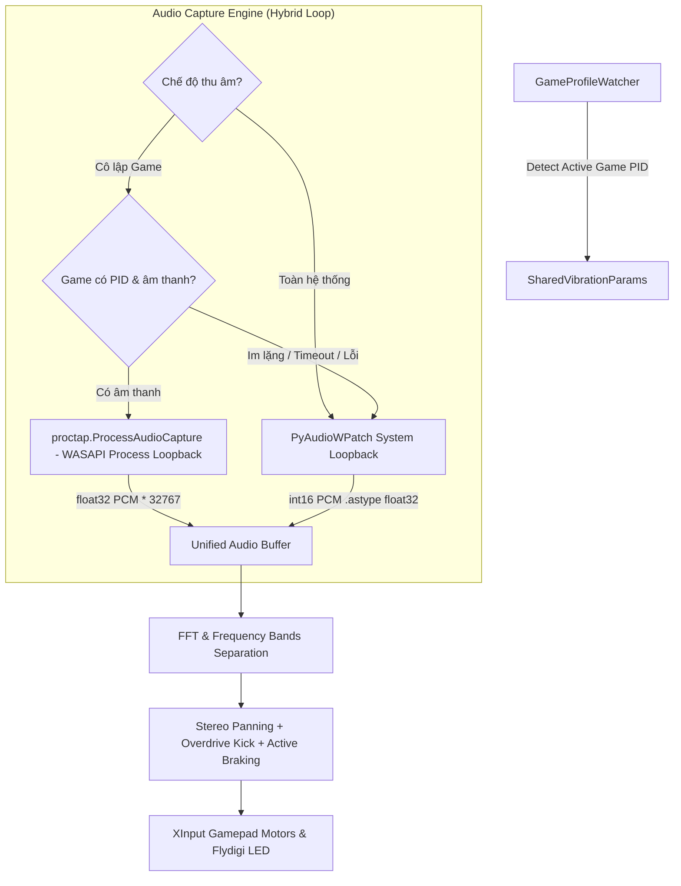

# Thiết Kế Kỹ Thuật: Phase 2 - Cô Lập Âm Thanh Theo Tiến Trình Game (Per-Process Audio Isolation)

- **Dự án**: Xbox Audio Rumble Studio
- **Phiên bản mục tiêu**: v1.2.0 (Phase 2)
- **Tác giả**: Huyenbk97 & Antigravity
- **Ngày lập**: 11/10/2026
- **Trạng thái**: Đã phê duyệt phương án 1 (Approved Architecture - Option 1)

---

## 1. Mục Tiêu & Phạm Vi (Goals & Scope)

### 1.1. Mục tiêu
1. **Lọc sạch tạp âm bên ngoài**: Khi người dùng chơi game, loại bỏ 100% các nguồn âm thanh khác trong Windows (cuộc gọi Discord, xem video YouTube trên trình duyệt, nghe nhạc Spotify) để tay cầm **chỉ rung theo đúng âm thanh trong game**.
2. **Tự động hóa hoàn toàn**: Kết hợp cùng `GameProfileWatcher` (từ Phase 1). Khi phát hiện người dùng đang ở trong cửa sổ Game mục tiêu, tự động lấy `PID` của Game đó và kích hoạt chế độ thu âm cô lập tiến trình.
3. **Cơ chế dự phòng mượt mà (Fail-safe Seamless Fallback)**: Nếu Game đang ở màn hình tải (chưa phát ra âm thanh) hoặc khi người dùng Alt+Tab ra ngoài, hệ thống tự động hoàn về thu âm thanh hệ thống để không bao giờ bị đứt đoạn cảm giác rung. Khi game phát ra âm thanh trở lại, hệ thống lập tức tái kích hoạt cô lập.

### 1.2. Ngoài phạm vi Phase 2
- Rung cò LT/RT độc lập & Flydigi Force Feedback (Phase 3).
- Bộ chỉnh Visual Equalizer haptic tùy chỉnh dải tần (Phase 4).

---

## 2. Kiến Trúc Kỹ Thuật (Architecture & Components)

### 2.1. Sơ đồ luồng xử lý âm thanh kép (Hybrid Dual-Source Audio Engine)



### 2.2. Chi tiết các thành phần

#### 1. Bộ thu âm tiến trình (`ProcessAudioCapture` - `proctap`)
- Tận dụng Windows Audio Session API: `ActivateAudioInterfaceAsync` với `AUDIOCLIENT_ACTIVATION_TYPE_PROCESS_LOOPBACK`.
- Đầu vào: `PID` của game (số nguyên 32-bit).
- Đầu ra: Dữ liệu âm thanh 2 kênh (Stereo), 48.000 Hz, định dạng `float32`.
- Chuyển đổi chuẩn hóa:
  ```python
  samples = np.frombuffer(raw_bytes, dtype=np.float32) * 32767.0
  ```
  Nhờ nhân với `32767.0`, biên độ và phổ đo FFT đồng bộ 100% với luồng 16-bit PCM của `PyAudioWPatch`, bảo toàn toàn bộ các công thức tính toán Haptic sẵn có mà không gây sai lệch cường độ.

#### 2. Bộ quản lý chuyển đổi mượt mà (`HybridAudioManager`)
- Tích hợp bên trong `audio_vibration_thread`.
- Quản lý trạng thái:
  - `ACTIVE_PROCESS`: Đang thu âm từ tiến trình game độc quyền.
  - `FALLBACK_SYSTEM`: Game đang im lặng hoặc chưa có âm thanh, tạm thời đọc từ âm thanh tổng.
  - `SYSTEM_ONLY`: Người dùng chọn chế độ toàn hệ thống.
- Theo dõi cờ `silent_timer`: Nếu trong vòng 1.5 giây không nhận được gói tin âm thanh từ Game, tự động tráo sang `SysStream` để duy trì độ rung nền. Khi `ProcCapture` có dữ liệu trở lại, tráo mượt mà về `ProcCapture`.

#### 3. Điều khiển trên Giao Diện Người Dùng (GUI)
- Tại **Panel 1: Thiết bị & Cấu hình Preset**:
  - Thêm Combobox / Radiobutton lựa chọn nguồn thu:
    - `🔊 Toàn hệ thống Windows (Mặc định)`
    - `🎯 Tự động cô lập âm thanh theo Game đang chơi`
  - Nhãn hiển thị trạng thái `device_label`:
    - Khi cô lập thành công: `🎯 Nguồn âm: [cs2.exe - PID 12450] (Cô lập độc quyền)`
    - Khi fallback: `🔄 Nguồn âm: Toàn hệ thống (Chờ âm thanh từ cs2.exe)`
    - Khi toàn hệ thống: `🔊 Nguồn âm: Speakers (Realtek(R) Audio)`

---

## 3. Cấu Trúc Dữ Liệu Cài Đặt (Configuration Schema)

Cập nhật vào `XboxAudioRumbleStudio.settings.json`:

```json
{
  "audio_capture_mode": "auto_game_process",
  "auto_process_fallback": true
}
```

- `audio_capture_mode`: `"system"` hoặc `"auto_game_process"`.
- `auto_process_fallback`: `true` (cho phép tự động fallback về system loopback khi game im lặng).

---

## 4. Xử Lý Ngoại Lệ & Độ Trễ (Latency & Safety)

1. **Độ trễ thấp (< 5ms)**: Cả `proctap` (C++ WASAPI) và `PyAudioWPatch` đều giao tiếp ở tầng Kernel audio driver, đảm bảo độ trễ siêu tốc không đổi.
2. **Tiến trình tắt đột ngột (Crash / Exit)**: Khi Game bị tắt, luồng thu âm tiến trình bắt exception `ProcessLookupError` hoặc stream closed, lập tức giải phóng đối tượng capture và hồi về system loopback an toàn, không làm crash app.
3. **Đóng gói PyInstaller**: Cần bổ sung `--collect-all proctap` và `--collect-all scipy` để nhúng đầy đủ file thư viện C++ `_native.cp311-win_amd64.pyd`.

---

## 5. Kế Hoạch Xác Minh (Verification Plan)

1. **Kiểm thử Unit Test**:
   - Kiểm tra khởi tạo `ProcessAudioCapture` với PID hợp lệ và PID không tồn tại.
   - Kiểm tra chuyển đổi dữ liệu âm thanh từ `float32` sang chuẩn scale int16.
2. **Kiểm thử Live Hybrid Stream**:
   - Mở YouTube phát nhạc trên trình duyệt.
   - Chạy 1 game hoặc ứng dụng phát âm thanh riêng biệt.
   - Bật chế độ "Cô lập Game": Xác nhận chỉ âm thanh của game tạo ra rung, tiếng YouTube bị bỏ qua hoàn toàn.
   - Tắt game: Xác nhận app tự động fallback về âm thanh YouTube mượt mà.
3. **Kiểm thử đóng gói (.exe & Inno Setup v1.2.0)**:
   - Biên dịch single executable và test khởi động.
   - Biên dịch bộ cài `XboxAudioRumbleStudio-Setup-v1.2.0.exe`.
