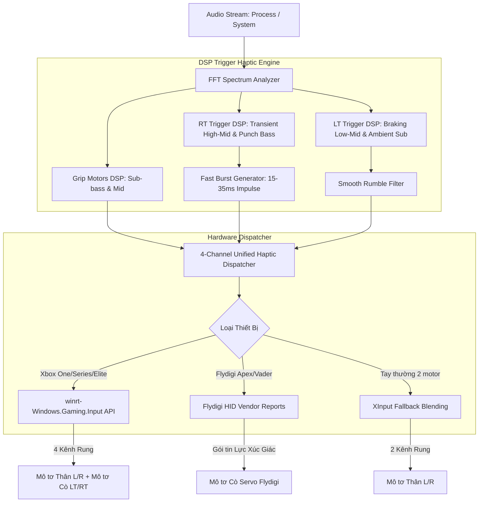

# Đặc Tả Kỹ Thuật: Phase 3 - Rung Độc Lập 2 Nút Cò LT/RT (Xbox Impulse & Flydigi Adaptive Triggers)

- **Phiên bản mục tiêu**: v1.3.0 (Phase 3)
- **Tác giả**: Antigravity Pair Programming
- **Trạng thái**: Bản thảo đã duyệt kiến trúc (Draft Approved)

---

## 1. Tổng Quan & Mục Tiêu

### 1.1. Bối cảnh
Trước Phase 3, phần mềm `Xbox Audio Rumble Studio` điều khiển 2 mô tơ rung thân chính qua chuẩn XInput (`wLeftMotorSpeed` và `wRightMotorSpeed`). Tuy nhiên:
- Tay cầm chính hãng Microsoft (Xbox One, Xbox Series X|S, Xbox Elite Series 2) trang bị thêm 2 mô tơ xúc giác độc lập gắn trực tiếp dưới 2 nút cò `LT` và `RT` (công nghệ **Xbox Impulse Triggers**).
- Các dòng tay cầm cao cấp của Flydigi (Apex 3, Apex 4, Vader 3 Pro, Vader 4 Pro) trang bị động cơ lực phản hồi xúc giác trong cò (**Adaptive / Force Feedback Triggers**).
- Việc kích hoạt 2 nút cò này mang lại trải nghiệm độ chìm đắm (immersion) vượt bậc: người chơi cảm nhận rõ từng viên đạn bắn ra giật nẩy ở ngón trỏ phải (RT) và cảm giác phanh trượt bánh / gầm gừ ở ngón trỏ trái (LT).

### 1.2. Mục tiêu Phase 3
1. **Điều khiển 4 kênh rung độc lập**: `LeftGrip`, `RightGrip`, `LeftTrigger`, `RightTrigger`.
2. **Hỗ trợ phần cứng đa dạng**:
   - Tay cầm Xbox One / Series X|S / Elite qua Windows Runtime `winrt-Windows.Gaming.Input`.
   - Tay cầm Flydigi Apex 3/4 & Vader 3/4 Pro qua giao thức USB HID Output Report.
   - Cơ chế tự động hòa trộn lực (Auto Blend Fallback) cho các tay cầm 2 mô tơ truyền thống mà không sinh lỗi.
3. **Thuật toán âm thanh chuyên biệt cho cò (DSP Audio Trigger Haptics)**:
   - Cò Phải (RT): Phản xạ tức thì theo tiếng súng đanh (`High-Mid 800 - 2500Hz`) và tiếng nổ giật xung (`Punch 100 - 250Hz`).
   - Cò Trái (LT): Rung rần theo phanh xe, động cơ gầm, va chạm và tiếng khiên đỡ đòn (`Low-Mid 150 - 600Hz`).
4. **Giao diện trực quan**: Điều chỉnh độ nhạy, thanh trượt lực rung cò riêng biệt, công tắc bật/tắt trên GUI Dark Mode tiếng Việt.

---

## 2. Kiến Trúc Hệ Thống (Architecture)



---

## 3. Chi Tiết Tầng Driver Phần Cứng (Hardware Abstraction Layer)

### 3.1. `Windows.Gaming.Input` Dispatcher
- Sử dụng package `winrt-Windows.Gaming.Input`.
- Quản lý instance gamepad:
  ```python
  from winrt.windows.gaming.input import Gamepad, GamepadVibration
  
  # Khi cập nhật lực rung:
  vibration = GamepadVibration()
  vibration.left_motor = float(left_grip)       # 0.0 -> 1.0
  vibration.right_motor = float(right_grip)     # 0.0 -> 1.0
  vibration.left_trigger = float(left_trigger)   # 0.0 -> 1.0
  vibration.right_trigger = float(right_trigger) # 0.0 -> 1.0
  gamepad.vibration = vibration
  ```
- Lợi thế: Driver Microsoft chính hãng gửi lệnh trực tiếp xuống controller firmware qua USB/Dongle/Bluetooth với độ trễ < 2ms, không cần can thiệp quyền Administrator hay cài driver ảo.

### 3.2. `FlydigiController` Trigger Expansion
- Mở rộng lớp `FlydigiController` trong `xbox6.py`:
  - Thêm phương thức `set_triggers(left_force: float, right_force: float, mode: int = 1)`.
  - Gửi gói tin Vendor Output Report (Report ID `0x03` / `0x05`) cấu hình độ cứng và độ rung xung cho 2 mô tơ servo của cò.

### 3.3. Cơ chế Fallback Thông Minh (Graceful Fallback)
- Nếu `winrt` không phát hiện tay cầm hỗ trợ 4 motor hoặc thiết bị trả về lỗi:
  - Hệ thống tự động chuyển sang `xinput.XInputSetState`:
    ```python
    blended_left = min(1.0, left_grip + left_trigger * 0.4)
    blended_right = min(1.0, right_grip + right_trigger * 0.4)
    ```
  - Đảm bảo hiệu ứng âm thanh từ dải cò không bị biến mất mà hòa vào thân tay cầm một cách êm ái.

---

## 4. Thuật Toán Xử Lý Tín Hiệu Cho Cò (DSP Trigger Audio Haptics)

### 4.1. Cò Phải (RT) - Bắn Súng & Xung Đột Phá
- **Đặc trưng tín hiệu**: Tiếng súng đạn, tiếng nổ lựu đạn, cú đấm mạnh hoặc tiếng tăng tốc xe đua.
- **Công thức tính toán**:
  - Biên độ `P_RT = (0.6 * RMS_Punch_Right + 0.4 * RMS_HighMid_Right) * trigger_right_gain`
  - Nếu `P_RT > trigger_threshold`:
    - Áp dụng xung kích hoạt nhanh (Fast Impulse Attack): Kích hoạt rung mạnh trong cửa sổ 20-35ms, sau đó ngắt dứt khoát bằng phanh xung để mô phỏng cảm giác "cò súng giật bật lại ngón tay".

### 4.2. Cò Trái (LT) - Phanh ABS & Âm Nền/Khiên
- **Đặc trưng tín hiệu**: Tiếng rê lốp khi phanh gấp trong Forza/Need for Speed, tiếng động cơ gầm gừ, tiếng gió rít hoặc tiếng va chạm bên trái.
- **Công thức tính toán**:
  - Biên độ `P_LT = (0.5 * RMS_LowMid_Left + 0.5 * RMS_Sub_Left) * trigger_left_gain`
  - Áp dụng bộ lọc làm mịn làm rần ngón tay (Smooth Exponential Smoothing, `alpha = 0.35`), tạo cảm giác gai tay ổn định và liên tục.

### 4.3. Các Chế Độ Vận Hành Cò (Trigger Modes)
1. `adaptive_gun_brake`: **Tự Động Tối Ưu (Khuyên dùng)** - RT tối ưu tiếng súng bắn/đột phá, LT tối ưu phanh/ngắm/âm nền.
2. `directional_stereo`: **Định Hướng Stereo Thuần Túy** - Âm thanh bên trái rung cò LT, âm thanh bên phải rung cò RT.
3. `linked_body`: **Đồng Bộ Toàn Dải** - Hai cò rung đồng pha trợ lực cho 2 mô tơ thân theo cường độ âm tổng.

---

## 5. Thiết Kế Giao Diện UI & Lưu Cấu Hình

### 5.1. Cụm Điều Khiển Trên Giao Diện (Panel 2 - Xúc Giác Nâng Cao)
- `Checkbutton`: `🔘 Bật rung 2 nút cò LT/RT (Xbox Impulse & Flydigi Triggers)`
- `Scale`: `Cường độ Cò Trái (LT - Phanh/Ngắm): [0% - 100%]` (Mặc định: 70%)
- `Scale`: `Cường độ Cò Phải (RT - Bắn/Ga): [0% - 100%]` (Mặc định: 85%)
- `Combobox`: Chế độ rung cò (Adaptive Gun & Brake / Directional Stereo / Linked Body)

### 5.2. Mở Rộng Schema (`SharedVibrationParams` & `settings.json`)
```python
@dataclass
class SharedVibrationParams:
    # Phase 3 Fields
    trigger_haptics_enabled: bool = True
    trigger_left_gain: float = 0.70
    trigger_right_gain: float = 0.85
    trigger_mode: str = "adaptive_gun_brake"
    trigger_threshold: float = 0.04
```

---

## 6. Kế Hoạch Kiểm Thử & Tiêu Chuẩn Nghiệm Thu

1. **Kiểm thử Schema & Settings**: Cấu hình lưu và đọc đúng định dạng json, đồng bộ 2 chiều với GUI.
2. **Kiểm thử WinRT WGI Dispatcher**:
   - Gọi lệnh rung 4 kênh `(0.5, 0.5, 0.8, 0.8)` trên tay cầm Xbox Series / One không gây exception.
   - Thử nghiệm rút và cắm lại tay cầm khi app đang chạy (Hotplug resilience).
3. **Kiểm thử Thuật toán DSP Trigger**:
   - Audio chứa tiếng súng ngắn tần số cao tạo xung giật đanh ở RT.
   - Audio chứa tiếng bass rền rĩ tạo rung mịn ở LT.
4. **Kiểm thử Đóng Gói PyInstaller & Setup v1.3.0**:
   - PyInstaller đóng gói kèm `winrt-Windows.Gaming.Input` và `winrt-runtime` vào file `.exe` duy nhất.
   - Biên dịch Inno Setup `XboxAudioRumbleStudio-Setup-v1.3.0.exe`.
